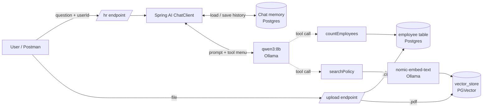

# HR AI Assistant

An HR assistant built with **Spring Boot** and **Spring AI** that answers employee and policy questions in plain English. It runs fully locally with **Ollama** (no API keys) and uses **PostgreSQL + PGVector** for storage.

Ask things like:

- *"How many Team Leads are on contract?"* → exact count from the database
- *"How many days of paid leave do I get?"* → answer from the HR policy PDF
- *"What did I ask you before?"* → remembers each user's conversation, even after a restart

---

## Architecture



### Key design decision: SQL for facts, vectors for meaning

| Data | Stored in | Used by | Why |
|---|---|---|---|
| Employee CSV (id, name, designation, type) | `employee` table | `countEmployees` tool | Structured data needs **exact** answers. SQL counts every row correctly. |
| HR policy PDF | `vector_store` (PGVector) | `searchPolicy` tool | Unstructured text needs **meaning-based** search. |
| Chat history | chat memory table | Memory advisor | Each user keeps their own conversation across restarts. |

Early versions used RAG for employee counts too. With 300 rows split into chunks, the model only saw a few chunks and gave confidently wrong totals. Moving counts into a SQL-backed tool fixed this.

---

## How a request flows

For *"How many Team Leads are on contract?"* (user `ravi`):

1. The `/hr` endpoint receives the question and user ID.
2. The memory advisor loads `ravi`'s recent messages from Postgres.
3. Spring AI sends the question, the history and the tool definitions (built from `@Tool` / `@ToolParam`) to the model.
4. The model replies with a **tool call**: `countEmployees(designation="Team Lead", employmentType="Contract")`.
5. Spring AI runs the Java method, which queries the `employee` table and returns `7`.
6. Spring AI sends the result back to the model, which writes the final answer.
7. The memory advisor saves the question and answer to `ravi`'s history.

The model never runs code or touches the database. It only reads text and asks for tools; the application does the work.

---

## Tech stack

- Java 21, Spring Boot 4, Spring AI 2.0
- Ollama (native, uses Apple Silicon GPU)
  - `qwen3:8b`: chat and tool calling
  - `nomic-embed-text`: embeddings (768 dimensions)
- PostgreSQL 17 with the pgvector extension (Docker)
- Spring Data JPA, JDBC chat memory

---

## Getting started

### 1. Start Ollama and pull the models

```bash
brew install ollama
brew services start ollama

ollama pull qwen3:8b
ollama pull nomic-embed-text
```

### 2. Start PostgreSQL with pgvector

Mapped to port **5433** so it doesn't clash with a local Postgres on 5432.

```bash
docker run -d --name pgvector -p 5433:5432 \
  -e POSTGRES_USER=postgres -e POSTGRES_PASSWORD=postgres -e POSTGRES_DB=hrdb \
  -v pgdata:/var/lib/postgresql/data \
  pgvector/pgvector:pg17
```

### 3. Configuration (`application.properties`)

```properties
# Ollama
spring.ai.ollama.base-url=http://localhost:11434
spring.ai.ollama.chat.options.model=qwen3:8b
spring.ai.ollama.embedding.options.model=nomic-embed-text

# Database
spring.datasource.url=jdbc:postgresql://localhost:5433/hrdb
spring.datasource.username=postgres
spring.datasource.password=postgres
spring.jpa.hibernate.ddl-auto=update

# Vector store
spring.ai.vectorstore.pgvector.initialize-schema=true
spring.ai.vectorstore.pgvector.dimensions=768

# Chat memory
spring.ai.chat.memory.repository.jdbc.initialize-schema=always
```

### 4. Run

```bash
./mvnw spring-boot:run
```

---

## API

### Upload data: `POST /upload`

Send a file as `multipart/form-data` with the key `file`. The file is routed by extension:

| Extension | Goes to | Notes |
|---|---|---|
| `.csv` | `employee` table | Header must be `id,name,designation,employmenttype`. Bad rows are skipped and counted. Re-uploading updates existing rows (id is the primary key). |
| `.pdf` | `vector_store` | Old chunks from the same file name are deleted first, so re-uploading doesn't create duplicates. |
| anything else | rejected | Returns `400 Bad Request`. |

```bash
curl -F "file=@employees.csv" http://localhost:8080/upload
# Saved 300 employees, skipped 0 bad rows

curl -F "file=@sample.pdf" http://localhost:8080/upload
# Stored 1 chunks from sample.pdf
```

### Ask a question: `GET /hr`

| Parameter | Description |
|---|---|
| `question` | The question in plain English |
| `userId` | Identifies the user's conversation history |

```bash
curl "http://localhost:8080/hr?userId=ravi&question=How many interns are there?"
```

---

## Example questions

| Question | Tool used | Answer source |
|---|---|---|
| How many full-time employees are there? | `countEmployees` | `employee` table |
| How many Team Leads are on contract? | `countEmployees` | `employee` table |
| How many days of paid leave do I get? | `searchPolicy` | Policy PDF |
| Which day must I come to the office? | `searchPolicy` | Policy PDF |
| What is the salary hike policy? | `searchPolicy` | Not in the PDF, so it says it doesn't know |
| What was my previous question? | none | Chat memory |

---

## Lessons learned

- **RAG is for finding, tools are for calculating.** Vector search returns the few most similar chunks, not every match, so counts over many rows come out wrong.
- **Tool descriptions are everything.** The model only sees a tool's name, description and parameters. Vague descriptions led to wrong tool choices; listing valid values fixed it.
- **Fewer tools work better with small models.** Three similar counting tools confused the model. One tool with optional filters did not.
- **Match strings case-insensitively.** The model may send `"team lead"` instead of `"Team Lead"`.
- **Persistent stores need duplicate handling.** In-memory stores reset on restart; Postgres doesn't, so loaders must check before inserting.
- **Model choice matters.** `llama3.2` (3B) called tools too eagerly. `qwen3:8b` chose tools correctly. Running Ollama natively instead of in Docker made it much faster on a Mac, because Docker can't use the GPU.

---

## Limitations and next steps

- [ ] **Authentication:** `userId` is a plain request parameter, so anyone can read another user's history. Next step: Spring Security with JWT, taking the user ID from the token.
- [ ] **Generic CSV support:** only the employee CSV format is accepted. Possible upgrade: store any CSV as JSONB with generic query tools.
- [ ] **Move upload logic into a service layer** to keep the controller thin.
- [ ] **Tests** for the upload routing and the tools.
